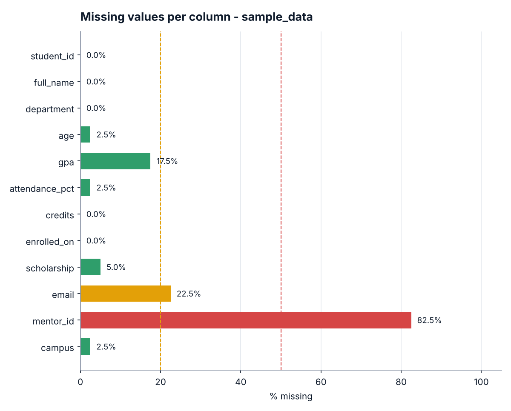
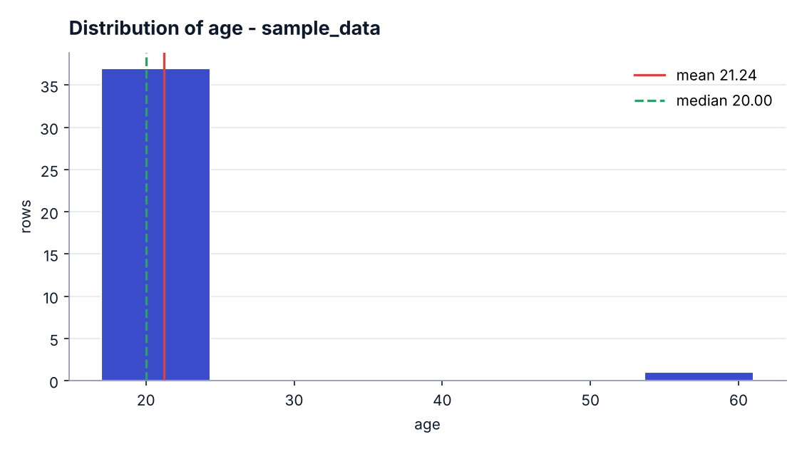
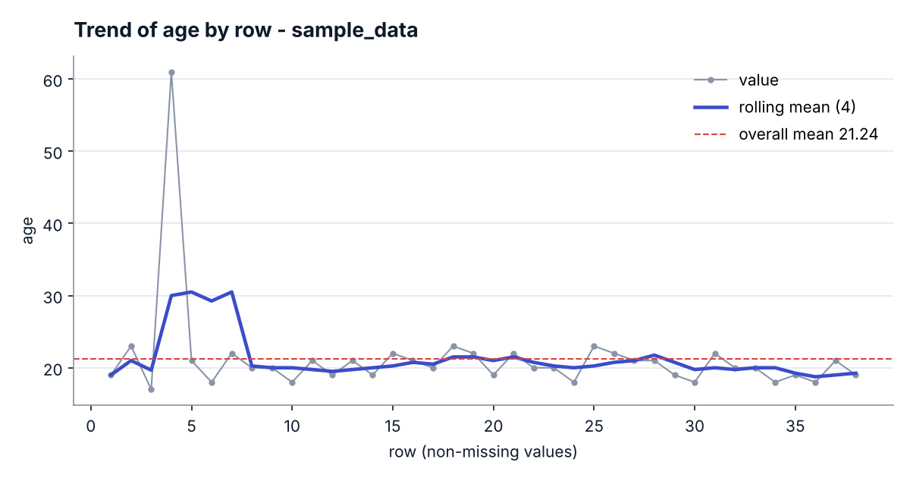
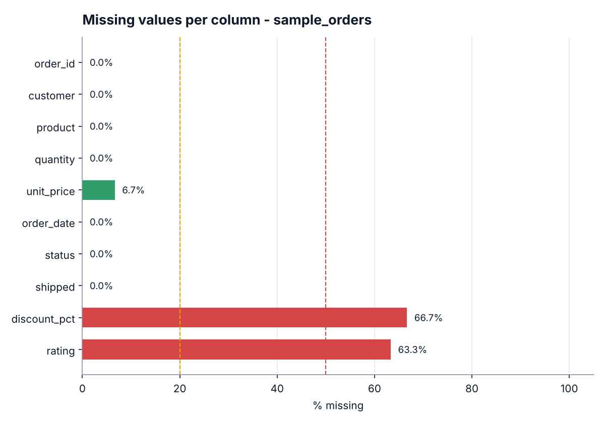
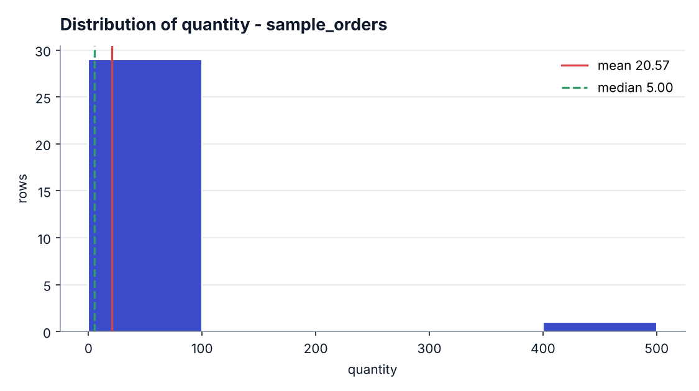
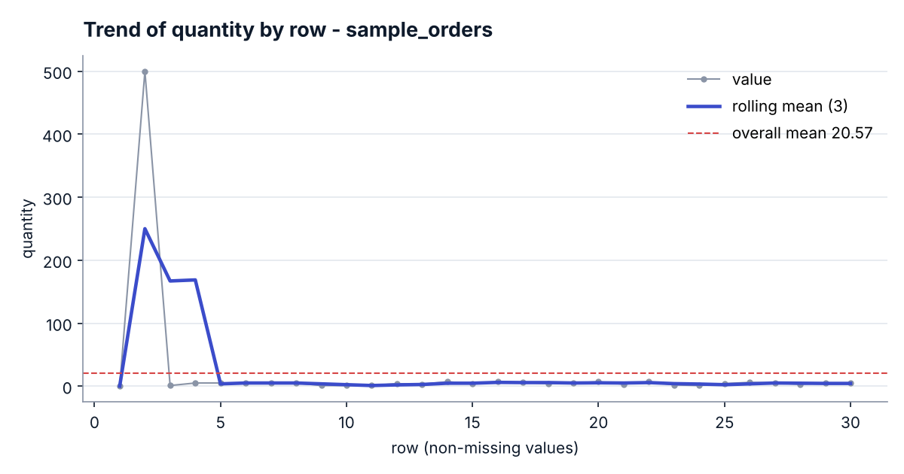
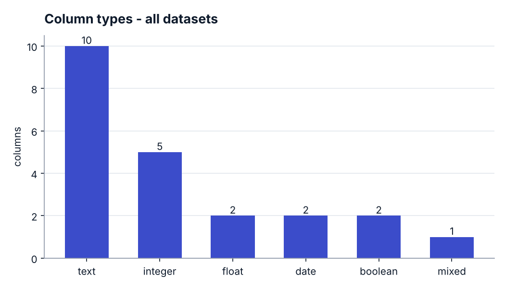
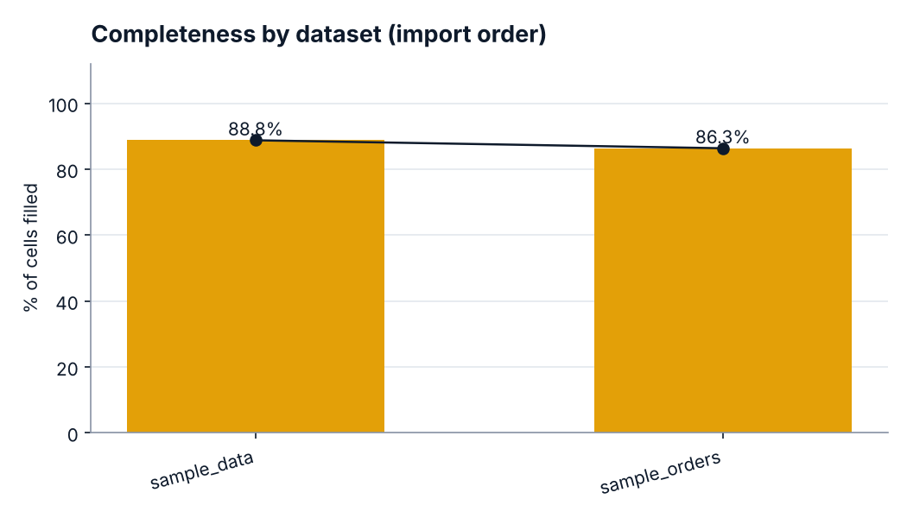

# CSV Column Summary Tool - Report

_Generated 2026-11-23 08:52 by CSV Column Summary Tool v1.0.0_

## Executive summary

| Metric | Value |
|---|---|
| Datasets | 2 |
| Total rows | 70 |
| Total columns | 22 |
| Cells filled | 87.8% |
| Average missing % per column | 12.3% |
| Overall status | Needs attention |
| Alerts (critical / warning / info) | 3 / 7 / 2 |

### Dataset status

| Dataset | Rows | Columns | Complete | Status |
|---|---|---|---|---|
| sample_data | 40 | 12 | 88.8% | Needs attention |
| sample_orders | 30 | 10 | 86.3% | Needs attention |

### Key trends

- Completeness declined across imports: sample_data 88.8% → sample_orders 86.3% (-2.4 pts).
- Least complete dataset: sample_orders (86.3% complete).
- 12 of 22 columns have no missing values.
- Most incomplete column: sample_data.mentor_id (82.5% missing).
- Most variable numeric column: sample_orders.quantity (coefficient of variation 4.40).
- Most common column type: text (10 of 22 columns).

## sample_data

Source: `/home/claude/csv_column_summary/data/sample_data.csv` · 40 rows · 12 columns · 88.8% complete

| # | Column | Type | Missing | Missing % | Unique | Min | Max | Mean | Median | Std dev |
|---|---|---|---|---|---|---|---|---|---|---|
| 1 | student_id | text | 0 | 0.0% | 40 |  |  |  |  |  |
| 2 | full_name | text | 0 | 0.0% | 40 |  |  |  |  |  |
| 3 | department | text | 0 | 0.0% | 6 |  |  |  |  |  |
| 4 | age | mixed | 1 | 2.5% | 9 | 17 | 61 | 21.24 | 20 | 6.82 |
| 5 | gpa | float | 7 | 17.5% | 27 | 0 | 4 | 2.82 | 2.62 | 0.75 |
| 6 | attendance_pct | integer | 1 | 2.5% | 26 | 0 | 250 | 83.72 | 81 | 32.53 |
| 7 | credits | integer | 0 | 0.0% | 4 | 12 | 21 | 16.95 | 18 | 2.85 |
| 8 | enrolled_on | date | 0 | 0.0% | 34 | 2024-08-02 | 2025-09-01 |  |  |  |
| 9 | scholarship | boolean | 2 | 5.0% | 2 |  |  |  |  |  |
| 10 | email | text | 9 | 22.5% | 31 |  |  |  |  |  |
| 11 | mentor_id | text | 33 | 82.5% | 7 |  |  |  |  |  |
| 12 | campus | text | 1 | 2.5% | 1 |  |  |  |  |  |

**Warnings**

- **CRITICAL** mentor_id: 82.5% missing (33/40) - above 50% limit.
- **WARNING** (dataset): 1 row(s) were rejected during import.
- **WARNING** age: Mixed value types (integer: 38, text: 1).
- **WARNING** age: 1 outlier value(s) outside the IQR range (min 17, max 61, Q1 19, Q3 21.75).
- **WARNING** attendance_pct: 2 outlier value(s) outside the IQR range (min 0, max 250, Q1 71, Q3 93.50).
- **WARNING** email: 22.5% missing (9/40) - above 20% limit.
- **WARNING** gpa: 1 outlier value(s) outside the IQR range (min 0, max 4, Q1 2.39, Q3 3.32).
- **INFO** campus: Every non-missing value is identical (constant column).
- **INFO** enrolled_on: Newest date is 448 days old (2025-09-01).

## sample_orders

Source: `/home/claude/csv_column_summary/data/sample_orders.csv` · 30 rows · 10 columns · 86.3% complete

| # | Column | Type | Missing | Missing % | Unique | Min | Max | Mean | Median | Std dev |
|---|---|---|---|---|---|---|---|---|---|---|
| 1 | order_id | text | 0 | 0.0% | 30 |  |  |  |  |  |
| 2 | customer | text | 0 | 0.0% | 30 |  |  |  |  |  |
| 3 | product | text | 0 | 0.0% | 7 |  |  |  |  |  |
| 4 | quantity | integer | 0 | 0.0% | 9 | 0 | 500 | 20.57 | 5 | 90.57 |
| 5 | unit_price | float | 2 | 6.7% | 7 | 12.75 | 89 | 53.56 | 54.25 | 24.02 |
| 6 | order_date | date | 0 | 0.0% | 30 | 2026-03-01 | 2026-10-27 |  |  |  |
| 7 | status | text | 0 | 0.0% | 4 |  |  |  |  |  |
| 8 | shipped | boolean | 0 | 0.0% | 2 |  |  |  |  |  |
| 9 | discount_pct | integer | 20 | 66.7% | 3 | 5 | 15 | 10 | 10 | 4.08 |
| 10 | rating | integer | 19 | 63.3% | 5 | 1 | 5 | 3.09 | 3 | 1.58 |

**Warnings**

- **CRITICAL** discount_pct: 66.7% missing (20/30) - above 50% limit.
- **CRITICAL** rating: 63.3% missing (19/30) - above 50% limit.
- **WARNING** quantity: 1 outlier value(s) outside the IQR range (min 0, max 500, Q1 3, Q3 5).

## Charts

